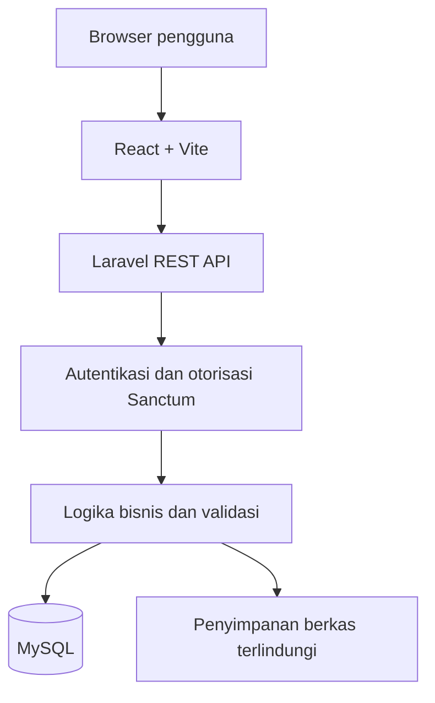

# SIAKAD SMA — Sistem Informasi Akademik Sekolah

**Web-Based Senior High School Academic Information System**

SIAKAD SMA adalah aplikasi berbasis web untuk mendukung pengelolaan administrasi dan kegiatan akademik sekolah secara terintegrasi. Sistem dirancang untuk digunakan oleh **Tata Usaha (TU), Kepala Sekolah, Guru, dan Siswa**, dengan hak akses yang disesuaikan dengan tanggung jawab masing-masing.

> **Status proyek:** Dalam pengembangan dan verifikasi integrasi. Dokumen ini menjelaskan cakupan dan tata cara kerja proyek berdasarkan spesifikasi yang tersedia. Tidak semua fitur di bawah dinyatakan selesai atau telah diterima pengguna. **User Acceptance Test (UAT) belum dilaksanakan**, dan kesiapan produksi masih memerlukan pengujian serta persetujuan sekolah.

## Daftar Isi

1. [Latar Belakang dan Tujuan](#latar-belakang-dan-tujuan)
2. [Teknologi](#teknologi)
3. [Arsitektur Sistem](#arsitektur-sistem)
4. [Fitur Utama](#fitur-utama)
5. [Peran dan Hak Akses](#peran-dan-hak-akses)
6. [Aturan Akademik Penting](#aturan-akademik-penting)
7. [Persiapan Lingkungan](#persiapan-lingkungan)
8. [Menjalankan Proyek Secara Lokal](#menjalankan-proyek-secara-lokal)
9. [Impor Data Awal](#impor-data-awal)
10. [Pengujian](#pengujian)
11. [Dokumentasi Proyek](#dokumentasi-proyek)
12. [Keamanan dan Privasi](#keamanan-dan-privasi)
13. [Pembagian Tugas](#pembagian-tugas)
14. [Pengembangan Selanjutnya](#pengembangan-selanjutnya)

## Latar Belakang dan Tujuan

Pengelolaan data akademik yang tersebar pada berbagai berkas dapat menyulitkan pencatatan, pencarian, pemantauan, dan penyusunan laporan. SIAKAD SMA dikembangkan untuk menyediakan tempat pengelolaan data akademik yang terstruktur serta membedakan akses informasi berdasarkan peran pengguna.

Tujuan pengembangan:

- Memudahkan pengelolaan data siswa, guru, kelas, mata pelajaran, dan tahun akademik.
- Mendukung proses jadwal pelajaran, presensi, penugasan, serta penilaian siswa.
- Menyediakan akses akademik yang relevan bagi guru, wali kelas, siswa, dan kepala sekolah.
- Mendukung rekapitulasi dan ekspor laporan sesuai kewenangan pengguna.
- Menjaga konsistensi data antarsemester dan tahun akademik, termasuk riwayatnya.

## Teknologi

| Komponen | Teknologi |
| --- | --- |
| Frontend | React + Vite |
| Backend | Laravel 13 |
| API | Laravel REST API |
| Database | MySQL |
| Autentikasi | Laravel Sanctum |
| Lingkungan pengembangan | Laragon, Visual Studio Code |
| Format laporan | PDF dan Excel |

Versi dependensi yang lebih spesifik mengikuti berkas konfigurasi dan *lockfile* pada repository aplikasi.

## Arsitektur Sistem



**Pembagian tanggung jawab:**

- **React** menangani tampilan, navigasi, formulir, dan komunikasi dengan API.
- **Laravel** menangani autentikasi, otorisasi, validasi, aturan akademik, akses data, dan layanan pelaporan.
- **MySQL** menyimpan data terstruktur, relasi, dan riwayat akademik.
- **Penyimpanan berkas aplikasi** digunakan untuk bahan ajar, tugas, dan dokumen rapor; akses dokumen privat harus melalui endpoint yang diotorisasi.

Menu yang tersembunyi di frontend **bukan** pengganti pemeriksaan otorisasi di backend.

## Fitur Utama

Daftar berikut menyatakan **cakupan fitur SIAKAD** yang didokumentasikan, bukan jaminan seluruhnya telah selesai diuji.

| Modul | Fungsi utama |
| --- | --- |
| Landing page dan login | Pengenalan sekolah, autentikasi akun, keluar dari aplikasi |
| Dashboard | Ringkasan informasi sesuai peran dan konteks pengguna |
| Manajemen akun | Pembuatan akun, status akun, peran, dan reset kata sandi oleh TU |
| Tahun akademik | Pengaturan periode aktif, semester, dan riwayat periode |
| Data siswa | Pengelolaan identitas akademik siswa |
| Data guru | Pengelolaan identitas dan informasi guru |
| Mata pelajaran | Pengelolaan daftar mata pelajaran |
| Kelas dan anggota kelas | Pengelolaan kelas dan penempatan siswa oleh TU |
| Wali Kelas | Penugasan guru pada kelas/periode tertentu dan pemantauan kelas binaan |
| Jadwal pelajaran | Pengaturan serta penampilan jadwal belajar/mengajar |
| Presensi | Pencatatan Hadir, Izin, Sakit, dan Alpa; rekap sesuai akses |
| Bahan ajar | Pengunggahan dan distribusi materi pembelajaran |
| Tugas siswa | Pembuatan tugas, pengumpulan, dan pemantauan tugas |
| Penilaian | Komponen nilai, entri nilai, dan rekap nilai |
| Rapor | Unggah, lihat, dan unduh dokumen rapor resmi sesuai hak akses |
| Laporan akademik | Rekap serta ekspor PDF/Excel sesuai jenis laporan dan kewenangan |
| Profil | Melihat dan memperbarui data profil yang diizinkan |

### Jenis laporan yang didokumentasikan

Jenis laporan yang menjadi bagian dari rancangan mencakup `students`, `teachers`, `classes`, `schedules`, `attendance`, `grades`, dan `semester-recap`. Ketersediaan dan cakupan ekspor ditentukan oleh otorisasi server serta konteks akademik yang berlaku.

**Catatan rapor:** Pengelolaan rapor tahap awal menggunakan dokumen resmi yang diunggah oleh TU. Sistem **tidak mengasumsikan** rumus nilai rapor otomatis sebelum ketentuan resmi sekolah tersedia.

## Peran dan Hak Akses

| Peran | Akses utama |
| --- | --- |
| **Tata Usaha (`TU`)** | Administrasi akun, siswa, guru, kelas, mata pelajaran, jadwal, tahun akademik, rekap presensi/penilaian, dokumen rapor, dan laporan |
| **Kepala Sekolah (`KEPALA_SEKOLAH`)** | Dashboard monitoring, jadwal, rekap presensi, penilaian, serta laporan tingkat sekolah sesuai izin |
| **Guru (`GURU`)** | Jadwal mengajar sendiri, presensi, bahan ajar, tugas, penilaian, serta pelaporan dalam konteks mengajar |
| **Siswa (`SISWA`)** | Jadwal kelas, presensi sendiri, nilai sendiri, materi, pengumpulan tugas, dan rapor sendiri |

**Wali Kelas bukan role login kelima.** Wali Kelas adalah *assignment* tambahan pada akun berperan `GURU`, yang berlaku untuk kelas dan periode akademik tertentu. Guru dengan assignment ini dapat memantau kelas binaannya sesuai aturan, tetapi pengelolaan keanggotaan/penempatan siswa tetap menjadi kewenangan TU.

## Aturan Akademik Penting

1. **Data per periode.** Tahun akademik dan semester harus memisahkan data berjalan dari data historis.
2. **Kewenangan berbasis konteks.** Guru hanya dapat mengelola aktivitas pada jadwal mengajarnya; siswa hanya dapat melihat/mengubah data yang memang menjadi haknya.
3. **Wali Kelas adalah penugasan.** Akses Wali Kelas mengikuti kelas dan periode yang aktif, bukan sekadar nama role di antarmuka.
4. **Keanggotaan kelas dikelola TU.** Wali Kelas dapat memantau daftar anggota kelas binaan, tetapi tidak dapat menambah/menghapus keanggotaan.
5. **Keabsahan presensi.** Status yang digunakan adalah `HADIR`, `IZIN`, `SAKIT`, dan `ALPA`, dengan perlindungan terhadap catatan ganda untuk siswa/jadwal/tanggal yang sama.
6. **Rumus penilaian resmi.** Bobot dan komponen nilai harus mengikuti keputusan sekolah; jangan menyamakan rata-rata komponen laporan dengan nilai akhir rapor.
7. **Dokumen privat.** Berkas rapor, bahan ajar tertentu, dan pengumpulan tugas harus diperiksa kepemilikan serta hak aksesnya sebelum diunduh.

## Persiapan Lingkungan

Siapkan lingkungan pengembangan berikut:

- Laragon dengan PHP dan MySQL yang kompatibel dengan versi Laravel dalam proyek.
- Composer.
- Node.js dan npm yang sesuai dengan konfigurasi frontend.
- Git dan Visual Studio Code (disarankan).
- Salinan repository lengkap yang berisi kode `backend` dan `frontend`.

> **Penting:** Pada sesi penyusunan README ini, yang tersedia adalah dokumen spesifikasi dan audit, bukan checkout repository aplikasi yang sedang berjalan. Oleh karena itu, langkah instalasi di bawah adalah panduan umum yang **harus dicocokkan** dengan nama folder, berkas `.env.example`, *scripts*, dan dependensi di repository aktual.

## Menjalankan Proyek Secara Lokal

Contoh struktur yang digunakan oleh dokumentasi pengembangan:

```text
siakad/
├── backend/       # Laravel REST API
├── frontend/      # React + Vite
├── docs/          # Dokumentasi tambahan, jika dipisahkan
└── README.md
```

### 1. Menyiapkan backend

Buka terminal di direktori `backend`:

```bash
cd backend
composer install
```

Buat berkas `.env` berdasarkan `.env.example` (jika tersedia), kemudian sesuaikan konfigurasi lokal. Di Windows CMD dapat menggunakan:

```cmd
copy .env.example .env
```

Contoh parameter koneksi database **lokal** pada `.env`:

```dotenv
DB_CONNECTION=mysql
DB_HOST=127.0.0.1
DB_PORT=3306
DB_DATABASE=siakad
DB_USERNAME=root
DB_PASSWORD=
```

Buat database pengembangan dengan nama yang sesuai sebelum melakukan migrasi. Nama database dan kredensial di atas adalah **contoh**, bukan konfigurasi yang telah diverifikasi dari repository.

Setelah `.env` diatur:

```bash
php artisan key:generate
php artisan migrate
php artisan serve
```

Jalankan *seeder* hanya apabila memang disediakan dan sesuai dengan lingkungan pengembangan. **Jangan menjalankan migrasi/reset database sembarangan pada database yang sudah berisi data sekolah atau produksi.**

### 2. Menyiapkan frontend

Buka terminal lain pada direktori `frontend`:

```bash
cd frontend
npm install
npm run dev
```

Pastikan konfigurasi *base URL* API pada frontend mengarah ke backend yang sedang dijalankan. Nama variabel lingkungan dan metode autentikasi browser harus mengikuti implementasi aktual pada API client dan konfigurasi Sanctum, bukan diasumsikan dari README.

Alamat akses lokal akan ditampilkan oleh masing-masing server saat dijalankan.

### 3. Alur masuk aplikasi

1. Buka halaman login dari frontend.
2. Gunakan akun pengembangan yang telah dibuat melalui proses administrasi/seeding yang sah.
3. Backend memverifikasi kredensial, status akun, peran, dan konteks penugasan.
4. Pengguna masuk ke dashboard sesuai peran dan hanya dapat mengakses data yang diizinkan.

Endpoint autentikasi yang didokumentasikan antara lain:

| Metode | Endpoint | Fungsi |
| --- | --- | --- |
| `POST` | `/api/login` | Login akun |
| `GET` | `/api/me` | Mengambil informasi akun dan konteks autentikasi |
| `POST` | `/api/logout` | Logout |
| `GET` | `/api/profile` | Profil pengguna |
| `PUT` | `/api/profile/password` | Perubahan kata sandi |

## Impor Data Awal

Untuk migrasi data siswa dari berkas administratif sekolah, gunakan alur berikut apabila fitur impor proyek mendukungnya:

**Tahap 1 — Akun pengguna**

| username | name | email | role_code |
| --- | --- | --- | --- |
| NISN siswa | Nama siswa | Email yang tersedia, atau kosong bila diizinkan | `SISWA` |

**Tahap 2 — Data akademik siswa**

Header sumber data sekolah yang digunakan pada persiapan impor:

```text
Nama | NIPD | JK | NISN | Tempat Lahir | Tanggal Lahir | Alamat | HP | Rombel Saat Ini
```

- **NIPD** dipetakan sebagai **NIS** pada data akademik siswa, sesuai kebutuhan impor yang telah ditentukan.
- **NISN** digunakan sebagai pengenal akademik yang menghubungkan akun dan profil siswa, sesuai aturan pemetaan importer.
- **Rombel Saat Ini** memerlukan pencocokan terhadap data kelas dan periode akademik yang sudah ada; jangan menganggap label rombel sebagai pengganti ID kelas/periode.
- Nilai identitas yang kosong tidak boleh diisi dengan data rekaan.
- Siswa yang memiliki nama sama, termasuk saudara kembar, **tidak boleh** otomatis dianggap duplikat. Gunakan pemeriksaan beberapa atribut identitas.

**Periksa kontrak impor aplikasi terlebih dahulu:** tidak semua form/API impor menerima header sumber mentah. Pemetaan ke field database dan relasi akun harus dikonfirmasi pada implementasi aktual. Jangan memasukkan file berisi data pribadi siswa ke repository publik.

## Pengujian

Strategi pengujian meliputi:

- **Unit Test:** validasi dan aturan bisnis yang terisolasi.
- **Backend/API Feature Test:** autentikasi, otorisasi, validasi, respons, dan integritas data.
- **Integration Test:** keterhubungan React, Laravel, database, dan penyimpanan dokumen.
- **Black Box Testing:** alur fitur dari sudut pandang pengguna.
- **User Acceptance Test (UAT):** penerimaan sistem oleh pengguna akhir sekolah.
- **Responsive & Accessibility Check:** tampilan desktop, tablet, dan ponsel, termasuk navigasi dasar.

Contoh perintah pengujian backend (jalankan dari `backend`):

```bash
php artisan test
php artisan test --filter=ReportTest
php artisan test --filter=ClassMemberTest
```

**Wajib:** pastikan lingkungan testing memakai **database pengujian terpisah**. Beberapa pengujian menggunakan `RefreshDatabase` dan dapat mereset data pada database yang salah.

Contoh pengujian frontend (jalankan dari `frontend`; jika struktur test tersebut tersedia):

```bash
node --test tests/*.test.mjs
npm run build
```

### Status verifikasi

Dokumen audit fase 6 mencatat kandidat integrasi dan bukti pengujian sebelumnya, tetapi tetap meminta pengujian ulang pada checkout lokal serta pengujian manual sebelum merge/rilis. **UAT dengan pengguna akhir belum dilaksanakan**; hasil dan status penerimaan UAT tidak boleh ditulis sebagai *Pass/Diterima* tanpa bukti pelaksanaan.

## Dokumentasi Proyek

Proyek menggunakan urutan otoritas berikut:

```text
Kebutuhan Sekolah
  ↓
00_MASTER_REQUIREMENTS.md
  ↓
01_PROJECT_RULES.md
  ↓
Spesifikasi Teknis
  ↓
Implementasi Kode
  ↓
Pengujian dan Deployment
```

Dokumen utama yang digunakan dalam pengembangan:

| Dokumen | Kegunaan |
| --- | --- |
| `00_MASTER_REQUIREMENTS.md` | Kebutuhan utama sekolah |
| `01_PROJECT_RULES.md` | Aturan dan batasan proyek |
| `02_SYSTEM_ARCHITECTURE.md` | Arsitektur dan tanggung jawab komponen |
| `03_ROLES_AND_PERMISSIONS.md` | Peran, izin, dan lingkup akses |
| `04_FEATURE_SPECIFICATION.md` | Spesifikasi modul |
| `05_DATABASE_SCHEMA.md` | Struktur konseptual basis data |
| `06_API_SPECIFICATION.md` | Kontrak REST API |
| `07_FRONTEND_ARCHITECTURE.md` | Struktur frontend |
| `08_UI_UX_DESIGN_SYSTEM.md` | Prinsip UI/UX dan desain visual |
| `09_REPORTING_AND_DOCUMENTS.md` | Pelaporan dan pengelolaan dokumen |
| `10_AUTHENTICATION_SPECIFICATION.md` | Autentikasi dan manajemen akun |
| `11_TESTING_SPECIFICATION.md` | Strategi dan cakupan pengujian |
| `12_DEPLOYMENT_SPECIFICATION.md` | Persiapan deployment |
| `13_DEVELOPMENT_WORKFLOW.md` | Alur pengembangan dan review |
| `14_TASK_DIVISION_NABIL_CLAUDIO.md` | Pembagian tanggung jawab tim |
| `CHANGELOG.md` | Riwayat keputusan/perubahan |

Keputusan tambahan mengenai akses Wali Kelas, data laporan, desain dokumen, dan *workspace* pelaporan Guru perlu disinkronkan dengan spesifikasi utama sebelum rilis. Lokasi dokumen dalam repository dapat berbeda dari paket dokumentasi yang digunakan untuk menyusun README ini.

## Keamanan dan Privasi

- Jangan menyimpan password dalam bentuk teks biasa; gunakan hashing yang aman.
- Seluruh endpoint privat harus memeriksa autentikasi dan otorisasi pada backend.
- Batasi data berdasarkan peran, penugasan mengajar, kelas binaan, periode akademik, dan kepemilikan.
- Validasi tipe, ekstensi, ukuran, dan lokasi penyimpanan file.
- Jangan membuka lokasi penyimpanan dokumen privat melalui URL publik yang mudah ditebak.
- Jangan mengunggah `.env`, token, kata sandi, *database dump*, data NIK/NISN siswa yang nyata, atau dokumen rapor ke repository publik.
- Lakukan *backup* terhadap database **dan** penyimpanan berkas.
- Gunakan HTTPS, konfigurasi produksi yang aman, serta pengujian ulang sebelum deployment.

## Pembagian Tugas

| Anggota | Tanggung jawab utama |
| --- | --- |
| **Nabil** | Backend Laravel, database MySQL, API, autentikasi, otorisasi, logika bisnis, dokumen dan pelaporan backend |
| **Claudio** | Frontend React, UI/UX, halaman, komponen, navigasi, responsive design, dan integrasi API di sisi frontend |
| **Bersama** | Review kebutuhan, kontrak API, integrasi, pengujian, perbaikan, dan keputusan kesiapan modul |

Proses pengembangan mengikuti prinsip **modul dianggap selesai setelah frontend, backend, integrasi, dan pengujian relevan terpenuhi**, bukan hanya ketika tampilan atau endpoint sudah dibuat.

### Alur Git

```text
feature/<nama-modul> → develop → main
```

- `feature/*` untuk pekerjaan modul.
- `develop` untuk integrasi dan pengujian lintas modul.
- `main` untuk revisi stabil sesuai persetujuan rilis.

## Pengembangan Selanjutnya

Pengembangan lanjutan diprioritaskan berdasarkan kebutuhan resmi sekolah dan hasil verifikasi, antara lain:

1. Menyelesaikan pengujian integrasi, penerimaan pengguna, dan pemeriksaan hak akses setiap role.
2. Memvalidasi kualitas laporan PDF/Excel, termasuk data panjang dan halaman lebih dari satu.
3. Melengkapi dokumentasi pengguna dan prosedur operasional sekolah.
4. Mengoptimalkan performa, tampilan responsif, keamanan, backup, dan observabilitas.
5. Meninjau kebutuhan otomatisasi rapor **hanya setelah** sekolah menetapkan format serta rumus penilaian resminya.

---

**SIAKAD SMA** — *Sistem Informasi Akademik Sekolah / School Academic Information System*  
**Tahun dokumentasi:** 2026
